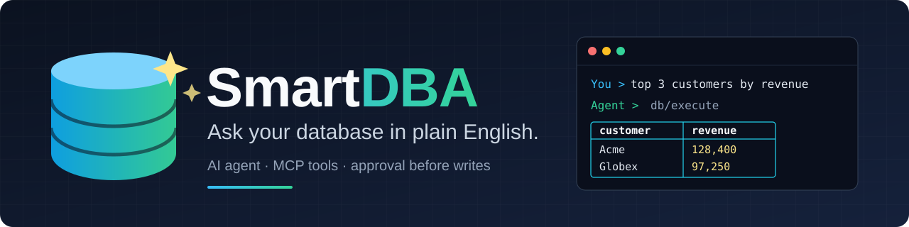

<p align="center">
  
</p>

<p align="center">
  <a href="https://github.com/tinystruct/tinystruct-smart-dba/releases"></a>
  <a href="../LICENSE"></a>
  
  <a href="https://github.com/tinystruct/tinystruct"></a>
  
  <a href="https://github.com/tinystruct/tinystruct-smart-dba/stargazers"></a>
</p>

<p align="center">
  <a href="../README.md">English</a> | <a href="README_zh.md">简体中文</a> | <a href="README_ja.md">日本語</a>
</p>

# SmartDBA - AI データベースエージェント

SmartDBA は、[tinystruct](https://github.com/tinystruct/tinystruct) フレームワーク（1.7.35）を基盤とする AI データベースエージェントです。「最新の注文を 10 件表示して」のように自然言語で依頼すると、エージェントが SQL を生成し、MCP データベースツールを使って実行し、結果を整形された表としてターミナルに表示します。

## 主な機能

- **対話型 CLI**：モデルの応答をリアルタイムでストリーミング表示し、Markdown（見出し、リスト、コードブロック、表）を ANSI カラーで描画します。
- **MCP 経由のデータベースツール**：テーブル一覧の取得、スキーマの確認、検索、挿入、更新、削除、SQL の直接実行（JOIN、サブクエリ、CTE）に対応します。
- **JDBC 対応データベースとの連携**：MySQL/MariaDB、PostgreSQL、SQLite、H2、SQL Server など、JDBC ドライバーを提供するデータベースを利用できます。スキーマ情報は JDBC メタデータから取得し、識別子の引用方法は SQL 方言に合わせて調整します。
- **Gemini および OpenAI 互換 LLM に対応**：デフォルトは Gemini（`gemini-3.5-flash-lite`）です。
- **HTTP + SSE**：同じ `chat` アクションを HTTP 経由でも利用でき、Server-Sent Events によりトークン単位で更新を配信します。
- **会話履歴の保持**：会話履歴を `.agent_history.json` に保存します。オプションのスキルファイルを指定すると、モデルへの追加の指示を与えることもできます。

## 安全性の仕組み

モデルの出力は、信頼できない入力として扱います。

- **書き込みには承認が必要です。** `db/insert`、`db/update`、`db/delete`（`typesafe.routing.confirm-actions` の一覧）、ファイルへの書き込み、シェルコマンドの実行時には、ターミナルで `[y/N]` による確認を求めます。
- **直接実行する SQL は事前に分類します。** `db/execute` は、読み取り専用であると判定できた場合にのみ確認なしで実行します。複数の SQL 文、コメント、書き込みを示すキーワードを含む場合は読み取り専用とみなさないため、`WITH ... DELETE` も検出されます。読み取り専用と判定できない SQL は、実行前に承認が必要です。TypeSafe キーが設定されている場合は、JEV モデルも読み取り専用 SQL を追加でレビューします。
- **承認できる人がいない場合、書き込みは実行しません。** 対話型ターミナル以外（HTTP の `chat` アクションなど）では承認を受け付けられないため、書き込み、シェルコマンド、変更を伴うツール呼び出しを拒否します。
- **ファイルアクセスの範囲を制限します。** エージェントの `read` と `write` アクションは、ワークスペース内（`agent.workspace`、デフォルトは作業ディレクトリ）のファイルにのみアクセスできます。`application.properties` と `.agent_history.json` へのアクセス、および `..` やシンボリックリンクを使って範囲外にアクセスするパスはブロックします。
- **WHERE 句を検証します。** `db/update` と `db/delete` には WHERE 句が必須です。単純な条件式のみを許可し、サブクエリ、`UNION`、DML/DDL、コメント、複数の SQL 文、常に真となる条件は許可しません。ただし、WHERE 句はそのまま SQL テキストに埋め込まれるため、実質的な安全策は承認であると考えてください。

データベースへの接続には、エージェントに与えてよい権限だけを持つアカウントを使用してください。

## 前提条件

- Java 17 以降
- Maven 3.6 以降（または同梱の `mvnw`）
- JDBC 対応データベースと、クラスパスに配置した対応ドライバー
- Google Gemini または OpenAI 互換 API のキー

## クイックスタート

デフォルトで組み込み H2 データベースが設定されているため、API キーを用意するだけで始められます。

```bash
git clone https://github.com/tinystruct/tinystruct-smart-dba.git
cd tinystruct-smart-dba
./mvnw package -DskipTests          # ビルドし、依存ライブラリを lib/ にコピー
```

Gemini の API キーを設定します。サンプル設定は環境変数 `GEMINI_API_KEY` から読み取るため、設定ファイルの編集は不要です。

```bash
export GEMINI_API_KEY=your-key       # Linux / macOS
```
```powershell
$env:GEMINI_API_KEY = "your-key"     # Windows PowerShell
```

プロジェクトのルートディレクトリから起動します。

```bash
bin/dispatcher chat                  # Linux / macOS
```
```bat
bin\dispatcher.cmd chat              # Windows
```

起動後、例えば `書名と著者の列を持つ books テーブルを作成し、3 件のデータを追加して表示して` と入力してみてください。書き込み時には承認を求められます。

日本語や中国語などの非 ASCII テキストは、追加設定なしで扱えます。起動スクリプトがコンソールと JVM を UTF-8 に設定します（Windows では `chcp 65001`、JVM には `-Dfile.encoding=UTF-8`）。IDE など別の方法で起動する場合は、JVM オプションに `-Dfile.encoding=UTF-8` を追加してください。Windows で文字を読みやすく表示するには、Windows Terminal を使用してください。

## 設定

設定はすべて `src/main/resources/application.properties` にあります。`$_NAME` と記述した値は、環境変数 `NAME` から読み取ります。

```properties
# LLM
agent.api_key=$_GEMINI_API_KEY        # キーを直接指定することも可能
agent.model=gemini-3.5-flash-lite
# agent.api_url=...                   # OpenAI 互換エンドポイント。デフォルトは Gemini
# agent.workspace=.                   # エージェントがアクセスできるルートディレクトリ
# agent.skill_file=path/to/SKILL.md   # モデルへの追加の指示（デフォルトは空）

# データベース（サンプルのデフォルト: ホームディレクトリ内の組み込み H2）
driver=org.h2.Driver
database.url=jdbc:h2:~/test
database.user=
database.password=

# 内部 MCP サーバー。トークンはサンプル値から変更してください。
mcp.server.url=http://localhost:8080/
mcp.auth.token=123456
```

**独自のデータベースを使う場合：** 対応する JDBC ドライバーを `pom.xml` に追加し（H2 と PostgreSQL は追加済みです。`sqlite-jdbc` や MySQL なども同様に追加できます）、`./mvnw package -DskipTests` を再実行してから、`driver`、`database.url`、`database.user`、`database.password` を更新します。例えば MySQL の場合は、次のように設定します。

```properties
driver=com.mysql.cj.jdbc.Driver
database.url=jdbc:mysql://localhost:3306/your_db
database.user=root
database.password=secret
```

PostgreSQL の場合（ドライバーは同梱されているため、`pom.xml` の変更は不要です）：

```properties
driver=org.postgresql.Driver
database.url=jdbc:postgresql://localhost:5432/your_db
database.user=postgres
database.password=secret
```

SmartDBA は接続先の現在のスキーマで動作します（デフォルトは `public`。変更するには URL に `?currentSchema=myschema` を追加します）。テーブル名は大文字と小文字を区別せずに照合します。また、PostgreSQL における識別子の小文字への変換、予約語、`SERIAL` キーの規則をエージェントに伝えます。

OpenAI 互換 API を使うには、`agent.api_url`（例：`https://api.openai.com/v1/chat/completions`）、`agent.model`、`agent.api_key` を設定します。

### 承認ルール（TypeSafe 設定）

```properties
typesafe.routing.confirm-actions=db/insert,db/update,db/delete
typesafe.api-key=$_TYPESAFE_API_KEY
```

- `typesafe.routing.confirm-actions` は、常に承認を求めるツールの一覧です。制限を厳しくするには `db/execute` などのツールを追加してください。既存の項目を削除することは推奨しません。
- `typesafe.api-key`（環境変数 `TYPESAFE_API_KEY`）は任意です。設定すると、TypeSafe JEV モデルが読み取り専用の `db/execute` SQL を追加でレビューします。未設定の場合は組み込みの読み取り専用判定を使用するため、どちらの場合も動作します。
- サンプルファイル内のその他の `typesafe.*` 設定（エンドポイント、モデル、信頼度のしきい値、キャッシュ、ワークフロー）は TypeSafe 連携用であり、デフォルトのままで構いません。

### ログ

デフォルトの `logging.enabled=FALSE` では、フレームワークの警告やエラーはログに出力されません。動作がおかしいのにターミナルに有用な情報が表示されない場合は、`TRUE` に設定してください。

### ポート

組み込み HTTP/MCP サーバーは tinystruct のデフォルトポートである 8080 で起動します。`mcp.server.url` はそのアドレスを指す必要があります。エージェントがサーバーを起動するため、別途サーバーを実行する必要はありません。

## 使い方

### 対話型セッション
```bash
bin/dispatcher chat
```
「今月登録されたユーザーを上位 5 件表示して」のように依頼を入力します。`clear` で履歴をリセットし、`exit` または `quit` で終了します。

### 単発のメッセージ
```bash
bin/dispatcher chat --message "すべてのテーブルを一覧表示して"
```
応答を表示して終了します。単発のメッセージでは承認を求められないため、読み取り専用の操作に限られます。データを変更する場合は、対話型セッションを使用してください。

### HTTP
アプリケーションの実行中は、ポート 8080 の tinystruct HTTP サーバーを通じて同じ `chat` アクションにアクセスでき、トークンが SSE でストリーミング配信されます。HTTP リクエストも、承認を受け付けられないため読み取り専用です。

## トラブルシューティング

| 症状 | 対処方法 |
|---|---|
| `API key not configured` | dispatcher を実行するシェルで `GEMINI_API_KEY`（または `agent.api_key`）を設定してください。 |
| `API returned status 400 ... API key not valid` | キーが誤っているか、別の API 用のキーです。`agent.model` と `agent.api_url` も確認してください。 |
| `ClassNotFoundException: org.tinystruct.system.Dispatcher` | 先に `./mvnw package -DskipTests` を実行して `lib/` に依存ライブラリを配置し、プロジェクトのルートディレクトリから dispatcher を実行してください。Windows では Bash スクリプトではなく `bin\dispatcher.cmd` を使用してください。 |
| ドライバーまたは `database.url` に関するエラー | JDBC ドライバーが `pom.xml` と `lib/` に含まれていることを確認してください。 |
| ポート 8080 が使用中 | `application.properties` で `server.port` を設定し、`mcp.server.url` も同じポートに更新してください。 |

## MCP 経由で公開するツール

| ツール | 用途 |
|---|---|
| `db/list-tables` | テーブルとビューの一覧を取得 |
| `db/describe` | テーブルの列、型、キーを取得 |
| `db/query` | 行を取得（WHERE 句と LIMIT は省略可能、最大 1000 件） |
| `db/insert` | 行を挿入（パラメーター化クエリ） |
| `db/update` | 行を更新（WHERE 句が必須） |
| `db/delete` | 行を削除（WHERE 句が必須） |
| `db/execute` | JOIN、CTE、DDL などの SQL を直接実行 |

## プロジェクト構成

- `SmartDBA.java`：チャットループ、LLM のストリーミング処理、Markdown レンダラー、承認ロジック。
- `SmartDBAServer.java`：データベースツールを登録する MCP サーバー。
- `tools/DatabaseTool.java`：MCP データベースツール、SQL の分類、WHERE 句の検証。

## テスト

```bash
./mvnw test
```

## ライセンス

Apache License 2.0。[LICENSE](../LICENSE) を参照してください。
